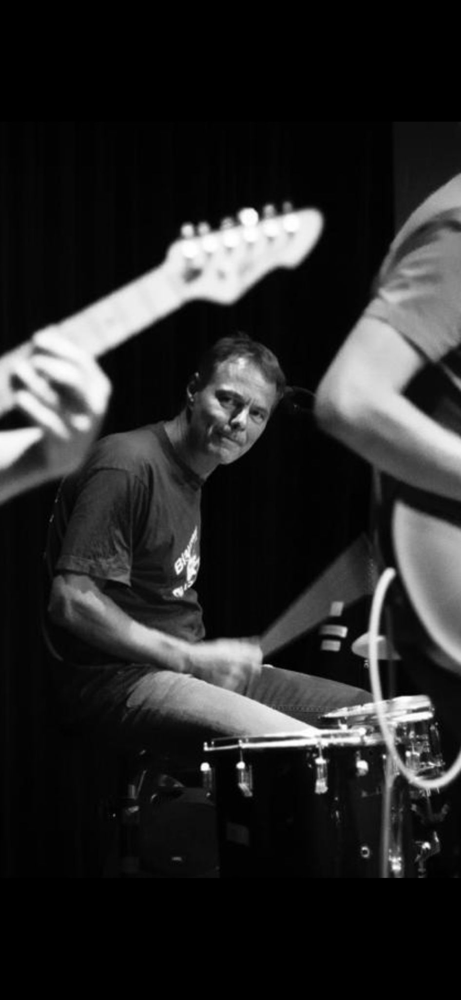
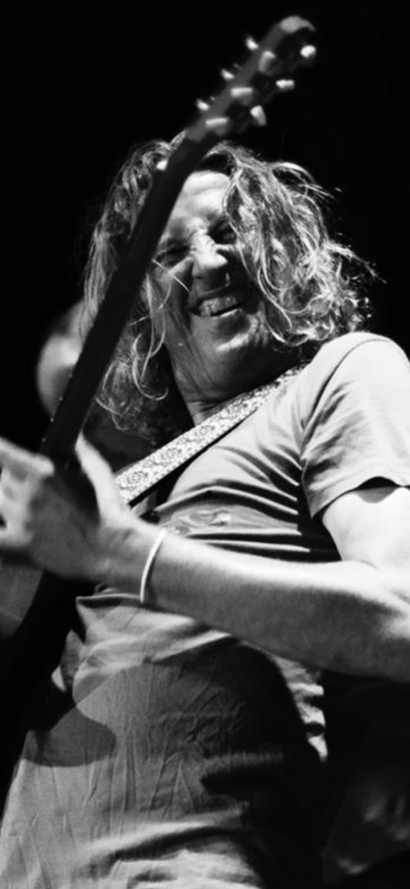
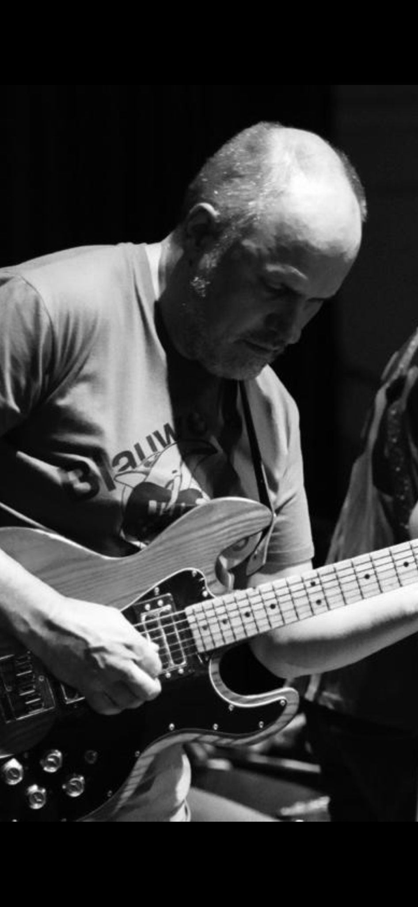
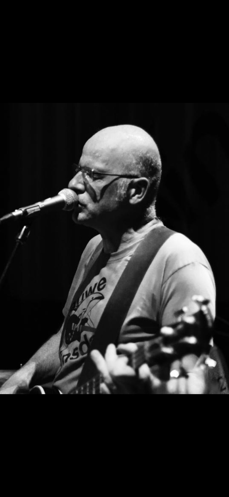

---
# Feel free to add content and custom Front Matter to this file.
# To modify the layout, see https://jekyllrb.com/docs/themes/#overriding-theme-defaults

layout: home
title: Thuis
---
 

  
  
  
  
  

  
 

{% include spotify.html type="album" id="0hpriflp4Fn6A1JMz7HWQl" title="Blauwe Dinsdag — Schreeuwende Snaren" height="352" width="98%" theme="0" %}

 
 
 
